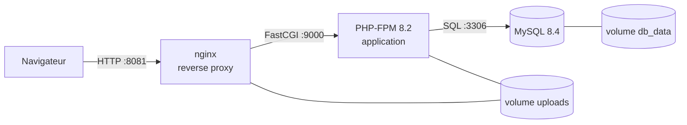

# Agence de location de voitures, conteneurisée

Site de location de voitures en PHP 8.2 et MySQL 8.4, déployé avec **Docker Compose** sur une VM Ubuntu Server.
Ce dépôt fait partie de mon lab d'apprentissage des infrastructures cloud : virtualisation, réseau Linux, conteneurs, puis Kubernetes et supervision.

## Architecture



| Service | Image | Rôle |
| --- | --- | --- |
| `web` | `nginx:stable-alpine` | Seul point d'entrée : sert les fichiers statiques et transmet le PHP |
| `app` | construite depuis le `Dockerfile` | Exécute le code PHP |
| `db` | `mysql:8.4` | Base de données, non exposée à l'extérieur |

Points clés :
- les conteneurs communiquent par **nom de service** grâce au DNS interne de Docker ;
- PHP ne démarre qu'une fois MySQL **réellement prêt**, grâce au `healthcheck` ;
- les données et les photos sont dans des **volumes** : elles survivent à la suppression des conteneurs ;
- le mot de passe est fourni par **variable d'environnement**, jamais écrit dans le code ;
- seul le dossier `public/` est servi par nginx ; la page `?page=health` sert de sonde de santé.

## Lancer le projet

Prérequis : Docker et Docker Compose.

```bash
git clone git@github.com:MTzerarga300/agence-location-cloud.git
cd agence-location-cloud
cp .env.example .env    # puis choisissez un mot de passe dans .env
docker compose up -d --build
docker compose ps       # attendre que db soit "healthy"
```

Le site est ensuite disponible sur `http://localhost:8081`.
Au premier accès, l'application crée ses tables et des données de démonstration.

## Comptes de démonstration

| Rôle | E-mail | Mot de passe |
| --- | --- | --- |
| Administrateur | admin@mohamedtayeb.com | admin123 |
| Agence 1 | agent1@mohamedtayeb.com | agent123 |
| Agence 2 | agent2@mohamedtayeb.com | agent456 |
| Mécanicien | mechanic@mohamedtayeb.com | mech123 |
| Client | client@mohamedtayeb.com | client123 |

## Organisation du code

```
public/       seul dossier exposé : point d'entrée, CSS, JavaScript, photos
src/          configuration, base de données, fonctions communes, gabarits
pages/        une page par fichier (accueil, connexions, 4 tableaux de bord)
nginx/        configuration du reverse proxy
Dockerfile    image de l'application PHP
docker-compose.yml
```

## Sécurité

- Requêtes SQL préparées, protection CSRF sur tous les formulaires.
- Mots de passe hachés, identifiant de session renouvelé à la connexion.
- Photos envoyées contrôlées (vrai fichier image, 5 Mo maximum).
- `.env` exclu de Git et de l'image Docker (`.gitignore`, `.dockerignore`).

## Feuille de route du lab

- [x] VM Ubuntu Server sous VirtualBox, accès SSH par clé
- [x] Réseau Linux, pare-feu, premiers conteneurs
- [x] Application en trois conteneurs avec Docker Compose
- [x] Publication sur GitHub
- [ ] Déploiement sur Kubernetes (k3s)
- [ ] Supervision avec Prometheus et Grafana
- [ ] Intégration continue avec GitHub Actions